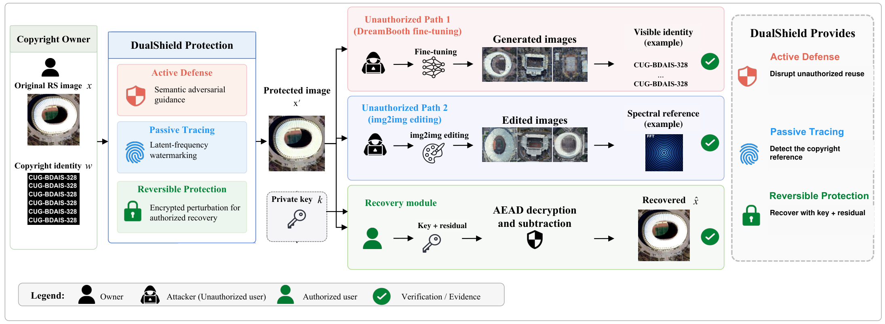
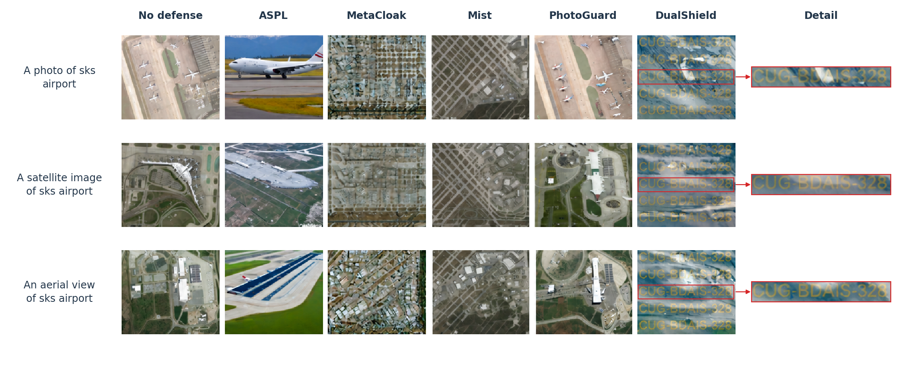

# DualShield

Source code accompanying **DualShield: Joint Adversarial Protection and Latent-Frequency Watermarking for Remote Sensing Images**.

DualShield combines copyright-guided adversarial protection with a latent-frequency watermark reference. This repository provides the model definitions, training and evaluation scripts, and selected paper figures.



## Contents

| Path | Contents |
| --- | --- |
| `models/perturbation_generator.py` | Perturbation generator and related network components |
| `models/watermark_extractor.py` | Watermark extraction network |
| `models/watermark_extractor_simple.py` | Alternative extraction network |
| `train_dual_watermark.py` | Protection-model training |
| `train_dreambooth_simple.py` | DreamBooth training and generation |
| `evaluate_dual_watermark.py` | Watermark evaluation |
| `evaluate_metrics.py` | Image-quality and generation metrics |
| `evaluate_ocr_watermark.py` | OCR-based inspection of visible copyright text |
| `assets/` | Method overview and qualitative examples |

## Setup

Use a Python environment with a CUDA-compatible PyTorch installation. Install the dependencies:

```bash
pip install -r requirements.txt
```

For OCR evaluation:

```bash
pip install -r requirements-ocr.txt
```

The `pytesseract` backend also requires the Tesseract executable. Choose a PyTorch build compatible with your CUDA environment before installing the remaining packages.

## Local inputs

Prepare your source images, copyright-reference image, and a local Stable Diffusion model directory. Supply their paths through the script arguments. Datasets, pretrained diffusion models, learned checkpoints, classifier weights, and generated runs are kept outside this repository.

The scripts retain their original experiment defaults. The commands below illustrate the available interfaces; choose the settings and checkpoints appropriate to your run.

## Training

```bash
python train_dual_watermark.py \
  --data_dir /path/to/source_images \
  --watermark_path /path/to/copyright.png \
  --vae_path /path/to/stable-diffusion \
  --output_dir ./output_dual_wm
```

DreamBooth experiments:

```bash
python train_dreambooth_simple.py \
  --data_dir /path/to/protected_images \
  --sd_path /path/to/stable-diffusion \
  --output_dir ./output_dreambooth
```

## Evaluation

```bash
python evaluate_dual_watermark.py \
  --model_path /path/to/checkpoint.pth \
  --data_dir /path/to/test_images \
  --watermark_path /path/to/copyright.png \
  --vae_path /path/to/stable-diffusion \
  --output_dir ./output_eval_dual
```

```bash
python evaluate_metrics.py \
  --gen_dir /path/to/generated_images \
  --orig_dir /path/to/original_images \
  --classifier_path /path/to/classifier.pth
```

Use `python <script>.py --help` for the arguments of each entry point. The OCR utility provides a separate inspection of visible text; its output is distinct from frequency-reference matching.

## Qualitative examples

The following paper figure compares generated outputs under three prompts. Red frames identify the regions enlarged in the rightmost column.



## Release scope

The experiment source files are preserved without algorithmic changes. This is a compact source release containing model definitions and selected figures. Obtain external datasets and foundation-model weights from their original providers under the corresponding terms. Third-party baseline repositories, local datasets, training artifacts, caches, and obsolete drafts are excluded.
